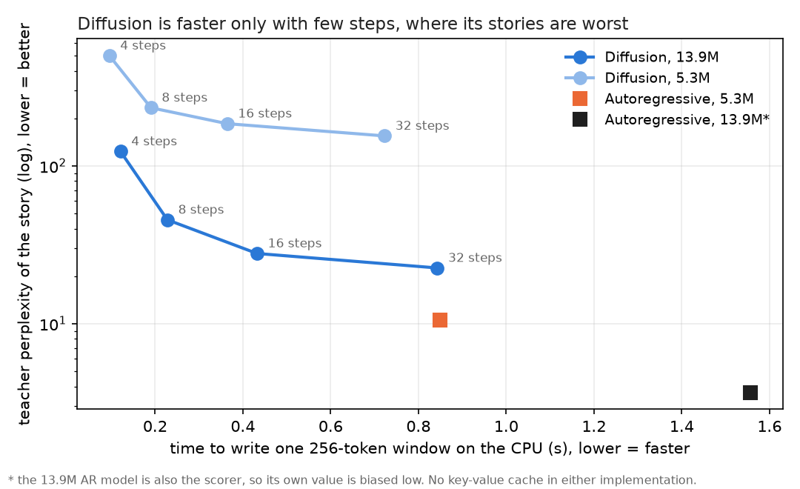
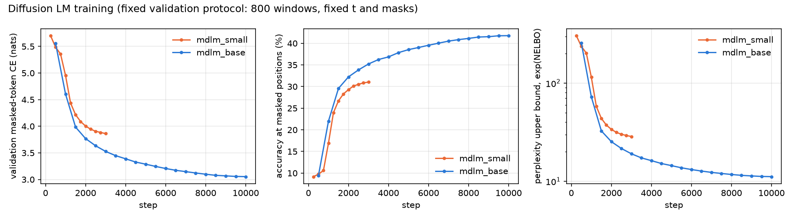
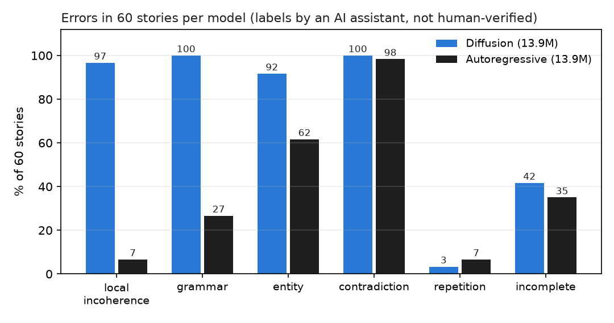

# Project 3 — A small diffusion language model for children's stories

**Question:** can a small *diffusion* language model, one that writes a whole story at once and refines it in a few
steps, match a normal left-to-right (*autoregressive*) model of the same size and training data? And is it faster?

**Short answer (CPU, TinyStories, 5–14M parameters): no, it does not match; it is faster only when it uses so few
steps that its stories fall apart.**

| | Diffusion (13.9M) | Autoregressive (13.9M, Project 1) | Autoregressive (5.3M, Project 2) |
|---|---|---|---|
| Perplexity on the same test text (lower = better) | ≤ 11.7 (upper bound) | **5.24** | 8.76 |
| Story quality, teacher perplexity (lower = better) | 22.5 (32 steps) … 123 (4 steps) | 3.7 (scores itself) | **10.6** |
| Variety of word pairs, Distinct-2 | 0.70 – 0.74 | 0.73 | 0.76 |
| Time for one 256-token window, CPU | **0.12 s** (4 steps) … 0.84 s (32 steps) | 1.56 s | 0.85 s |
| Typical error | doubled / misplaced words (97% of stories) | logic slips | logic slips |

The 13.9M diffusion model needs 32 steps to get its best stories, and then it is no faster than the 5.3M
autoregressive model, which writes stories about 2× more fluent with 2.6× fewer parameters.



---

## 1. What is a diffusion language model? (2-minute version)

A normal language model writes **left to right, one token at a time**: 200 tokens = 200 model calls.

A *masked diffusion* model learns a different game: **fill in the blanks**.

1. **Training.** Take a real story, hide a random fraction of its tokens behind a `[MASK]` symbol (sometimes 5%,
   sometimes 95%), and teach the model to guess the hidden ones. The model can look **both left and right**.
2. **Writing.** Start from a window that is **all** `[MASK]` (plus a prompt if you have one). In every step the
   model guesses *every* hidden position at once; a few of the guesses are kept, the rest are hidden again and
   guessed again in the next step. After S steps (here 4 to 32), nothing is hidden: the story is done.

So the number of model calls is S (4–32), not the story length (~200). That is the promise: speed. The risk:
tokens revealed **in the same step cannot see each other**, so neighbours may not fit together.

Schematic (not real model output):

```
step 0:  Tom had a big red ball . _ _ _ _ _ _ _ _ _ _ _ _ _ _ _ _ _ _ _ _ _
step 1:  Tom had a big red ball . _ _ _ the _ _ _ _ _ park _ _ _ _ . _ _ _
step 2:  Tom had a big red ball . He _ to the _ _ _ He _ park _ _ ball _ . _ _ _
 ...
step S:  Tom had a big red ball . He went to the park ... (all positions filled)
```

Run `python scripts/try_model.py --show_steps` to watch this happen with the trained model.

## 2. What was built

| Part | What it does | File |
|---|---|---|
| Tokenizer | Project 1's 8,192-token BPE + one new token `[MASK]` (id 8192); every old id unchanged | `mdlm/tokens.py` |
| Masking | hides each token with probability t, t uniform in (0.001, 1); the leading `<BOS>` is never hidden | `mdlm/masking.py` |
| Model | Project 1's Transformer with **bidirectional** attention (a test fails if it ever becomes causal) | `mdlm/model.py` |
| Training | cross-entropy on hidden tokens; AdamW, warm-up + cosine; fixed validation masks | `mdlm/train.py` |
| Generation | iterative unmasking; 3 schedules × 2 orderings × 7 sampling rules | `mdlm/generate.py` |
| Evaluation | fill-in test, likelihood bound vs. AR, settings grid, test prompts, errors | `mdlm/evaluate.py` |
| Speed | latency and memory for all four models on an idle CPU | `scripts/benchmark_generation.py` |

29 tests (`pytest`) check masking, attention direction and generation.

**Two models, each matched to an existing autoregressive (AR) model**, so only the modelling approach differs:

| Diffusion model | Shape | Params | Training | Matched AR model |
|---|---|---|---|---|
| `mdlm_small` | 4 layers, width 256 | 5.32M | 3,000 steps, 49M tokens, 1.3 h | Project 2's student trained alone (5.32M) |
| `mdlm_base` | 6 layers, width 384 | 13.89M | 10,000 steps, 164M tokens, 9.5 h | Project 1's teacher (13.89M) |

## 3. Training



Both models first learn only word frequencies (~10% of hidden tokens right), then suddenly learn to use the context
(steps 500–1,500). At the end, the base model guesses 42% of hidden tokens correctly. Both curves still fall at
the end, so more training would help a little.

## 4. Results

**Fill-in test (before any free writing).** On real test text, the base model restores 69% of tokens when 20% are
hidden, 56% at 50%, 32% at 80% and only 9% at 100% (it then guesses frequent words). The denoiser works; writing a
story from nothing is the hard part.

**Likelihood on identical test text** (1,000 windows, bootstrap 95% intervals). For diffusion only an upper bound
exists:

| Model | Perplexity |
|---|---|
| mdlm_small (5.3M) | ≤ 29.5 [28.7, 30.2] |
| mdlm_base (13.9M) | ≤ 11.7 [11.4, 12.0] |
| AR small (5.3M) | 8.76 [8.55, 8.99] |
| AR teacher (13.9M) | 5.24 [5.12, 5.37] |

**Which generation settings work** (chosen on separate development prompts, rule fixed before the test):

- **Which positions to reveal matters most.** Revealing the model's *most confident* guesses first gives smooth but
  **repetitive** stories (28–95% flagged): the easy slots fill with "went to the park", and later slots copy them.
  Revealing **random** positions removes the repetition. Selected: random order.
- **More steps = better stories:** teacher perplexity 123 → 45 → 28 → 22.5 at 4 → 8 → 16 → 32 steps.
- **Schedule hardly matters:** cosine is ~10% better than linear; a "reveal when confident" schedule saves almost no
  steps because the model is rarely ≥ 90% sure.
- **Sampling:** top-k 20 or temperature 0.7 is the best balance; plain argmax always loops.
- **No prompt needed:** unprompted stories are about as good as prompted ones.

**Stories from the same prompt** (base model, test prompt "Tom had a big red ball"):

> **Diffusion, 4 steps:** Tom had a big red ball. He likes a ball to make things with the ball. The ball is not
> every day. Tom goes Tom to. He day, and ball to the park. ball has a big ball He runs to hit the ball first…

> **Diffusion, 32 steps:** Tom had a big red ball and a ball into the yard. He liked to play with the ball at it.
> He ran and kick it to the ball. But Tom went up and saw the ball. She was curious. She ran to the pond…

> **Autoregressive, same size:** Tom had a big red ball. He liked to play with his ball in the park. He had a small
> ball. He could throw it high and far. He had a lot of fun. But then he saw a big dog…

## 5. What goes wrong

60 diffusion stories and 60 AR stories were mixed and labelled without knowing which model wrote which.
**The labels were produced by an AI assistant (Claude), not by a human annotator, and have not been checked by a
person.** Blinding is imperfect, because broken diffusion text is easy to spot.



The diffusion model's **signature error is local incoherence** (97% of stories vs 7%): doubled words ("ball ball",
"to the to the"), stray punctuation ("Suddenly,,") and words in impossible places. This is what one expects when
neighbouring tokens are chosen in the same step without seeing each other. Characters also drift more often
("Ben and Ben", "the dragon caught caught the dragon"). Logical contradictions are near 100% for **both** models under the strict
rule used, so that category does not separate them.

## 6. Conclusions

1. **Quality:** at equal size and data, the diffusion model is clearly worse than the AR model, both in likelihood
   (bound 11.7 vs 5.2) and in the stories it writes. Even the AR model with 2.6× fewer parameters wins.
2. **Speed:** with 4 steps diffusion is 13× faster than the same-size AR model, but those stories are unreadable.
   At 32 steps (its best stories) it is about as fast as the smaller AR model. An AR model with a key-value cache
   (not used here, by either model) would remove most of the remaining advantage.
3. **The key design choice is the reveal order.** Confidence-first reveal makes the model repeat itself; random
   reveal fixes it.
4. **Scale helps a lot** (5.3M → 13.9M: story perplexity 155 → 22.5), and both models were still improving, so the
   gap may shrink with more training and larger models. At this tiny scale and budget, it does not close.

**Limitations.** CPU only, one seed per model, one dataset; training times were slowed by other jobs on the same
machine (the speed benchmark ran on an idle CPU). The selection rule was changed once after the small model's
results (to also search random reveal order), before any base-model result existed; this is recorded in
`INSTRUCTIONS.md`. Not run: training-time mask schedules, time conditioning, a key-value-cache AR baseline, and a
human check of the error labels.

## 7. Try it yourself

```
cd project3
.venv\Scripts\activate
python scripts/try_model.py                                        # a story from the base model, 16 steps
python scripts/try_model.py --prompt "Tom found a red box" --steps 8 --show_steps
python scripts/try_model.py --steps 32 --compare_ar                # also write it with the AR teacher
python scripts/try_model.py --select confidence --steps 32         # see the repetition problem
```

Needs the trained checkpoints in `checkpoints/` (not in git) and Project 1 next to this folder (data, tokenizer and
the AR teacher are read from `../project1`, never changed).

## 8. Reproduce everything

```
python -m venv .venv && .venv\Scripts\activate && pip install -r requirements.lock.txt
pytest                                                             # 29 tests
powershell -ExecutionPolicy Bypass -File scripts\run_training.ps1  # small (~1.3 h), then base (~10 h)
python -m mdlm.evaluate --stage recon  --run mdlm_base             # also: nelbo, grid, final, errors
python scripts/benchmark_generation.py                             # on an idle PC
python scripts/error_counts.py                                     # after labelling
python scripts/plot_curves.py --run mdlm_small --run mdlm_base
python scripts/make_readme_figures.py
```

A beginner-friendly tutorial with interactive figures is in [project3.html](project3.html) (open it in a browser).
Every phase, decision and number is documented in [INSTRUCTIONS.md](INSTRUCTIONS.md). Results are in
`results/metrics/`, generated stories in `results/generations/`.
